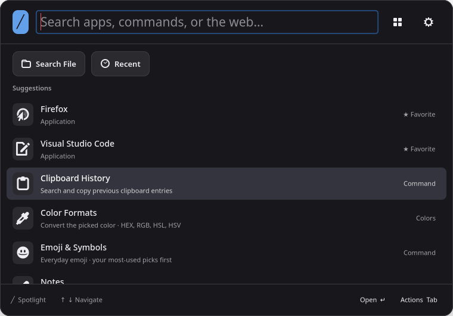

# Spotlight

A native Linux launcher written in Rust and GTK 4, with a dark Raycast-style interface. Designed for KDE Plasma on Wayland. No browser, Electron, account, or background clipboard recorder is required. Optional GNOME Calendar/Evolution integration uses the system Python and introspection libraries.



Actual GTK interface with demo data. [See file search](docs/images/spotlight-files.png).

## Expanded productivity tools

New: a [Secure Clipboard Vault, visual WASM workflows, and context-aware local AI](docs/SECURE_WORKFLOWS.md). Use `vault` to create a master password and migrate old pins; pins expire after one hour. `workflow` builds chains such as screenshot → OCR → translate → note. `ai ask …` previews the selected project's summary, open windows, and todos before sending to local Ollama.

- **File quick actions:** select a file or folder and press **Tab** or **Ctrl+K** for Reveal in Dolphin, Copy Path, Move to Trash, Copy File, Open With, and Get Info (including size and MIME). Trash asks for confirmation.
- **System search:** `ip` / `my ip`, `battery`, `disk`, `ram`, and `uptime` show copyable inline results. `ip local` skips public IP lookup.
- **Text and image utilities:** `qr hello` generates an offline UTF-8 QR image; `ocr` extracts text from clipboard images or screenshots with Tesseract. `lorem 5`, `case camel/snake/kebab text`, and `json format {"ready":true}` add local developer tools.
- **Clipboard pins and filters:** **Ctrl+K → Pin entry** keeps text or images in Spotlight. Use `clip text`, `clip images`, or `clip pinned`. Confirmed history clearing keeps pins.
- **Windows, tabs, and audio:** `close window`, `quit app`, and `kill window` find targeted KWin windows; quit/force-quit actions confirm first. `tabs chrome` searches recent Chrome/Chromium pages without a debug port; explicitly configured endpoints can also activate live tabs. `speakers` lists audio outputs and switches the selected device.
- **Packages, services, and devices:** `apt search`, `pacman Ss`, and `flatpak search` offer reviewed installation. `service status` lists user services; `systemctl restart docker` reviews a system service action. `bluetooth devices` and `bluetooth connect AirPods` list/connect known devices.

- **Developer workflow:** `code myproject` and `jetbrains myproject` reopen recent projects. `project ~/Projects/myproject` sets context for `gh pr list`, `gh issue bug`, and `dotenv`. `ssh myserver` opens a configured alias in Konsole; `env PATH` inspects environment values. Snippets support `{cursor}` and `{clipboard}` in trigger expansion and Espanso export.

- **Git dashboard, container tools and HTTP scratch:** `git status` lists dirty repositories under `~/Projects`; `docker logs nginx` (or `logs nginx`) tails logs inside Spotlight, and `docker exec nginx` opens an interactive container shell. `get https://api.github.com/user` opens a quick REST client with editable headers/body and a copyable response. `dotenv diff` compares `.env` with `.env.example` in the current project.
- **Dotfiles sync:** Settings → General exports snippets, saved notes, quick-note content and quicklinks to `spotlight/export.json` in an existing Git clone. Export commits only that file. Sync checks that the GitHub origin is private, then pushes it; other Git hosts can use local export.

- **Local AI and meeting availability:** `ai summarize clipboard` uses verified local-only Ollama; `meet in 2h` finds a slot from cached Akonadi calendars with recurrence handling. Both require their documented local dependencies.
- **Search preferences and Extension Store:** Settings → General configures aliases, web fallback, and root command categories. `store` browses a local TOML catalog and offers reviewed, checksum-verified WASM installation from GitHub releases or the bundled SDK example.

See **[commands, setup, requirements, and integration checks](docs/TOOLS.md)** for details. Press **F1** and search the Guide topic menu for **Passwords**, **Network tools**, **File vault**, **Wallpaper**, **Secure Clipboard Vault**, **Workflow walkthrough**, or **Context-aware AI**. The Guide includes local AI setup and a screenshot → OCR → translation → note walkthrough.

## New in v0.4.0

Music controls, local browser history and bookmarks, image and PDF tools, Markdown todos, Pomodoro timers, saved KDE window layouts, and clipboard paste queues are covered in the expanded 103-topic Guide. This release also adds a Git dashboard, container logs and shells, an HTTP scratch client, dotenv comparisons, and dotfiles export and sync.

## Interface and calendar

- **Cleaner main search:** apps and commands stay in the main results. **Search File** and **Recent** are pinned below the search box and open their own searchable views. Search File keeps the text you already typed.
- **Create calendar events by typing:** enter a title and date, review the details, and choose a calendar before saving. Supports configured GNOME Calendar/Evolution calendars and a local-only Spotlight calendar.
- **A complete built-in Guide:** browse 103 topics covering every app feature, with searchable topics, example commands, shortcuts, and requirements. Dedicated topics cover the new file actions, system tools, encrypted pins, visual workflows, local AI, and desktop integrations. Open it with **F1**, search `guide`, or choose **Settings → Guide**.
- **Theme-colored button glow:** buttons glow on hover and keyboard focus; selected buttons keep a soft glow using your accent color.

See the [release notes](CHANGELOG.md) for the full update.

Try `music`, `pause`, `next track`, or `play lofi` (opens a YouTube search; choose a track there). Music controls target a specific MPRIS player directly over session D-Bus. Search `history youtube` or `bookmark github` across local Firefox, Chrome, Chromium and Brave profiles. `screenshot` captures through the desktop portal, then keeps that capture for Copy Image and a Tab menu with OCR, QR decoding, Compress, Pin and Save.

The local file toolkit accepts paths, including spaces: `compress image 50% ~/Pictures/photo.png`, `resize 1080p ~/Pictures/photo.png`, `pdf text ~/Documents/report.pdf`, `image to webp ~/Pictures/photo.png`, and `palette ~/Pictures/photo.png`. Omit the path to choose a file. Image/PDF results also offer these actions in Ctrl+K. Compression saves quality-50 WebP; resize fits within 1920 × 1080 without upscaling. Conversions keep originals and choose an unused sibling filename. Palettes show up to five dominant colors with individual and collective copy buttons; flat images can have fewer colors.

Local workflows: `todo add buy milk` (or `todo buy milk`) appends a Markdown checkbox to `~/.local/share/spotlight/todos.md` (or `$XDG_DATA_HOME/spotlight/todos.md`). Open tasks appear in main search; Enter completes one. `todo` lists tasks, `todo done` reopens completed tasks, and **Open todos.md** opens the file for editing.

`pomodoro 25m` starts a focus timer with Caffeinate automatically enabled until completion or cancellation. `pomodoro` defaults to 25 minutes. Active sessions survive restarts and resume keeping the computer awake when Spotlight runs again. Manual Caffeinate remains independent; ordinary timers behave as before.

On KDE, `layout save work` saves current window positions; `layout work` (or `layout restore work`) restores them. `layout` lists saved layouts and `layout delete work` removes one. Restore arranges open apps, skips missing windows, and clamps positions to connected screens. Same-session window IDs take priority; after app restarts it uses application/title matches and skips ambiguous matches. Saving an existing name replaces its saved positions.

`clip queue` opens your clipboard pins for selection and ordering. Choose **Start paste queue**, then paste in your app with Ctrl+V repeatedly (or its normal paste shortcut). Text and PNG image pins are supported. The queue advances when an app requests clipboard content, with a 150 ms interval to group duplicate MIME requests; allow that interval between pastes. KDE Klipper is told to ignore queued offers. Other apps that proactively read clipboard content can consume an entry. Copying new content stops the queue; `clip queue stop` also stops it. Queue order is temporary and leaves saved pins intact.

## Build and install

See [Linux packages](docs/PACKAGING.md) for Debian/Ubuntu `.deb`, Fedora/openSUSE `.rpm`, Arch PKGBUILD, and tarball build recipes. Native package releases are not published yet.

**Nix/NixOS:** `nix profile install github:danny19862025/spotlight` installs the native launcher and its runtime dependencies. See the [Nix installation guide](docs/NIX.md) for flakes, declarative configuration, and optional-feature limits.

Follow the **[Linux installation guide](docs/INSTALL.md)** for Ubuntu/Kubuntu and derivatives, Debian, Arch and derivatives, Fedora, Fedora Atomic, openSUSE, Void, Gentoo, Alpine, NixOS, and other distributions. It includes dependency commands, Rust setup, shortcuts, updates, troubleshooting, and uninstall instructions.

Requires current stable Rust, GTK 4.10+ and SQLite3 development libraries, a C compiler/linker, and pkg-config. Once dependencies are installed:

```sh
git clone https://github.com/danny19862025/spotlight.git
cd spotlight
cargo fetch --locked
sh install.sh
"$HOME/.local/bin/spotlight"
```

Install as your normal user, without sudo. On KDE, run `~/.local/bin/spotlight --install-shortcut` to register **Meta+Space**. Existing shortcut conflicts are preserved. Other desktops need a custom shortcut in their keyboard settings; KDE integrations require KDE services.

The first launch stays running; launching it again toggles the panel. Escape hides it. Use **Quit Spotlight** to exit. Login startup is opt-in: run `spotlight --autostart` (or install with `sh install.sh --autostart`) to create a desktop entry that starts Spotlight hidden. Run `spotlight --no-autostart` to remove it. The entry uses `$XDG_CONFIG_HOME/autostart`, falling back to `~/.config/autostart`.

Move the pointer over a result to select it; Enter and the Open button use that selection. Arrow keys also select results. Background updates preserve the selection while the search stays the same.

Buttons glow in your theme's accent color on hover or keyboard focus, and selected buttons keep a soft glow.

## Try the new features

| What you want to do | How to do it |
| --- | --- |
| Find a file or folder | Type a name, then choose the pinned **Search File** button. Full paths also work. Enter opens folders in the file manager and files with their default app. |
| Browse recently opened items | Choose the pinned **Recent** button, then type to filter the list. |
| Prepare an event for a date | Type `event on July 13 2027`, press Enter, and fill in the title. |
| Create an all-day event | Type `event Birthday on July 13 2027`, then press Enter to review it. |
| Create an event with a time | Type `add event Dinner on July 13 2027 at 6pm`, then press Enter to review it. |
| Find an existing event | Type `calendar Birthday` and press Enter on a result to preview its details. |
| Learn any app feature | Press **F1** and open the topic menu. Type a feature name to find its guide page. |

In the event review form, edit the title, date, all-day setting, local start time, duration, or location. Choose the destination calendar, then select **Add Event** or press **Ctrl+Enter**. A date without a time is an all-day event. **Cancel** or **Escape** closes the form without saving.

Account calendars use the configured GNOME Calendar/Evolution service. **Spotlight (local only)** saves an iCalendar file on this computer without syncing it to an account. See [calendar setup and requirements](docs/PIM.md).

## Features

New local tools: `pass github` copies through rbw or KeePassXC (`keepass setup` chooses a database); `ping 8.8.8.8`, `dig github.com`, `my ports`, `my routes`, and `scan wifi` show copyable reports. `encrypt file`, `decrypt file`, `checksum file`, and `shred file` accept a local path or open a picker and are also in file actions. `wallpaper next` cycles local images; `accent blue` updates KDE and Spotlight. See [setup, behavior, and limits](docs/TOOLS.md#passwords-network-file-vault-and-appearance).

- Fuzzy application search with desktop icons, favorites, and usage ranking. Main search keeps apps and commands together; files live in separate views. Apps are ordered by match quality, favorites, and usage.
- Settings has flat, underlined General, Window, Theme, Guide, and About tabs. Window offers Compact and Expanded layouts and four interface sizes (90–125%); Apply changes updates the launcher and Settings immediately and remembers your choice. Settings buttons have a subtle hover glow. About shows the build version and a gently animated Spotlight logo; the logo respects the system animation preference. Theme offers Dark, Light, and Midnight presets, with color pickers and hex fields for background, text, accent, and selection colors. Preview changes before choosing Apply theme; preferences survive restarts. Reset colors restores the Dark preset in the editor, ready to apply.
- The built-in Guide has 103 topics covering every app feature, with instructions, example commands, shortcuts, and requirements. Press F1, search `guide` or `walkthrough`, or open Settings → Guide. The searchable topic menu jumps directly to a feature; Back and Next browse the catalog. Example buttons open a view or prepare a search for you to review. The guide remembers the current topic during the session, and Start searching returns to the launcher from any topic.
- **Search File** stays pinned below the main search box alongside **Recent**, above the scrolling results. Choose it to search by filename or path; it carries over text already typed in main search. File indexing starts when this view opens. Full paths appear under results. Bounded to 25,000 entries, six directory levels, excluding hidden files, symlinks, and build output. Home file search and Recent also respect `~/.spotlightignore` using gitignore patterns (examples below); ignored directories are pruned before indexing. Open files with their default application. Recent documents are included even when outside that index. Supported raster images display thumbnails decoded by a single background worker, with a bounded in-memory cache; files over 16 MiB or 16 million pixels keep their file icon.
- **Recent** opens a separate, searchable view of recently opened files and folders, newest first. Explicit commands `recent`, `recent files`, `recent folders`, and `recent report` also remain available. Reads the real XDG `recently-used.xbel` history and KDE `RecentDocuments` entries and includes recently used parent folders. Dotfiles, files inside hidden folders (such as `.config`), missing files, remote locations, and XDG private entries are excluded. History refreshes when Spotlight or the Recent view opens; Ctrl+R refreshes it. Visible files opened through Spotlight are registered with GTK's standard recent manager.
- Content search: `rg rust` or `content rust` searches inside home-folder files; `in: notes rust`, `in: ~/Projects TODO`, or `in: "Documents/My Notes" phrase`. `notes` searches Spotlight's local Quick Notes, an attached Obsidian vault, `~/Notes`, and `~/Documents/Notes`; other scopes are folders relative to home, `~/...`, or absolute paths. Uses `rg` (ripgrep) with literal text and smart case. Matches stream into the launcher after a 120 ms typing delay, with 40 ms UI polling; changing the query or hiding Spotlight cancels and reaps the old scan. Results show a filename, line number, and matching excerpt; Enter opens an inline preview with an Open in App button. Respects ripgrep's normal hidden-file, ignore, binary, and symlink rules, excludes common build folders, limits files to 1 MiB and depth to 12, and stops after eight seconds or 100 matches. Long-line previews are capped at 4,096 characters. Requires ripgrep on PATH.
- Calculator: arithmetic, parentheses, powers, percentages, `pi`, `e`, `sqrt`, trigonometry (radians), `ln`, `log`, `abs`, and `round`.
- Unit conversion: `10 km to mi`, `32 f to c`, `2 kg to lb`, `1 gib to mib`. Supports common unit names, volume, area, speed, and temperature symbols. Natural-language date calculations are not implemented.
- Currency conversion in the main search: `100 USD to AUD` or `50 eur in gbp`. Fetches the latest daily rates from [Frankfurter](https://frankfurter.dev/), shows the rate date, and copies with Enter. Requires internet and `curl`; rates are cached in memory for 15 minutes. These are reference rates, not tick-by-tick prices.
- Clipboard text and images through KDE Klipper: up to 60 text entries (64 KiB each), plus up to 24 images from its version-3 history database. Current clipboard images also work without saved Klipper history. Image rows show thumbnails; Enter copies the image, and Ctrl+K → Preview Image opens a larger view. Paste with Ctrl+V in your target app. Spotlight reads images when Clipboard History opens. Explicit pins save encrypted in the master-password vault and expire after one hour; other history stays in Klipper.
- Quick note capture from any app: press Meta+Space, type `note your text`, and press Enter. Search `Quick Note` for a multiline box; Ctrl+Enter saves, Escape keeps the draft in memory until Spotlight quits. “Save & Open” opens the saved note. Spotlight automatically connects when exactly one existing Obsidian vault is detected. Markdown notes save inside `Spotlight Quick Notes` in that vault, appear in main search, and open in Obsidian. Manage the connection or choose local-only capture in Settings. Vault notes are written directly as files, so Obsidian does not need to be running. `spotlight --quick-note` opens the capture box directly.
- Dictionary: type `define serendipity`, `dict word`, or `dictionary word`. English definitions, parts of speech, pronunciation text, and examples appear inside Spotlight; Enter copies a definition. Uses the [Free Dictionary API](https://dictionaryapi.dev/) over HTTPS, with a typing delay and one-hour session cache. Requires internet and `curl`; Ctrl+R retries a failed lookup.
- Offline translation: `translate en es cat`, `translate es en gato`, or `offline word` searches local dictd dictionaries and previews definitions inside Spotlight. `dictionaries` lists installed file dictionaries. Supports compressed FreeDict data and a local-only DICT server; no AI or internet lookup. This translates dictionary headwords, rather than arbitrary sentences. See [offline dictionary setup](docs/OFFLINE.md).
- Cheat sheets: `tldr tar`, `tldr git commit`, or `cheat curl`. Examples appear as copyable results; Enter on the first row opens the complete sheet inside Spotlight. The original bundled `tar` sheet works offline. Other commands fetch English Linux/common pages from [tldr-pages](https://github.com/tldr-pages/tldr), with a seven-day disk cache, source attribution, and its CC BY 4.0 license shown in the preview. Requires internet and `curl` for uncached pages. Examples are never executed.
- Text generators: `uuid` creates a random UUID v4; Ctrl+R creates another. `hash mytext` produces SHA-256; `hash sha512 text`, `hash sha1 text`, and `hash md5 text` select other checksums. `base64 encode mytext` and `base64 decode bXl0ZXh0` encode UTF-8 text or decode strict, standard padded Base64. Enter copies the full result. Use a JSON quoted string to preserve leading/trailing whitespace or escapes, for example `hash " a "` or `base64 encode "line1\nline2"`. Binary or NUL-containing decoded data is rejected. These tools run locally through GLib and accept up to 64 KiB of input.
- Calendar events: type `event Birthday on July 13 2027` or `add event Dinner on July 13 2027 at 6pm`. Enter opens a review form with editable title, date, all-day setting, local start time, duration, location, and calendar destination. A date without a time creates an all-day event. `event on July 13 2027` pre-fills the date and asks for a title. Choose **Add Event** (or Ctrl+Enter) to save to a configured GNOME Calendar/Evolution calendar; **Spotlight (local only)** saves an iCalendar file on this computer. Escape or Cancel closes without saving. Invalid dates/times are rejected, and saving disables repeat submissions. Search saved events with `calendar Birthday`; typing `calendar` also offers Add Calendar Event.
- Contacts and calendar search: `contacts Danny`, `contacts example.com`, or `calendar Rust`. Searches GNOME Calendar/Evolution events through Evolution Data Server, Akonadi/KAddressBook resources through an optional read-only native bridge, and local vCard/iCalendar files. Enter shows details inside Spotlight; Open in App opens file/Akonadi sources when available. See **[PIM setup and limits](docs/PIM.md)** for dependencies and account synchronization.
- Process killer: type `kill firefox` or `kill 12345`. Results show each matching process name, PID, and command line. Enter sends SIGTERM to that selected process. Only your own live processes are listed; Spotlight and PID 1 are excluded. The selected process identity is checked and pinned with a Linux pidfd before signalling. Ctrl+R refreshes the list.
- Git shortcuts: `git spotlight` or `repos sptlt` fuzzy-searches local repositories, including Git worktrees. Open a repository folder or its GitHub page. `gh repo view owner/repo` opens GitHub through `gh repo view --web`; local names work too. `git clone https://host/owner/repo.git` clones into `~/Projects/repo`, with the destination shown before running. HTTPS, `ssh://`, and `git@host:owner/repo.git` URLs are supported. Clone needs `git`; GitHub actions need GitHub CLI (`gh`). Authentication and SSH host trust must already be configured, as commands run without an interactive terminal. Existing destination folders are preserved. Repository discovery skips hidden directories, symlinks, and build output; it is bounded to 20,000 directories and seven levels below home.
- Docker/Podman: type `docker`, `podman`, or append a container name, ID, or image to filter. Results show running and stopped containers with their IDs, images, and status. Enter on **Stop** stops a running container; Enter on **Start** starts a stopped container. Paused or transitional containers are displayed without a start/stop action. Requires the corresponding CLI and access to its container engine; Spotlight never requests sudo. Results refresh after actions; Ctrl+R refreshes manually.
- Snippets, quicklinks, and editable notes stored locally. Snippets still copy with Enter. Add an optional unique **Trigger word** when creating or editing a snippet, such as `;sig`. Type that trigger followed by Space or Tab in Spotlight's search bar, Quick Note, or note editor to insert the full snippet directly. Triggers are case-sensitive and start at a whitespace boundary; pasted text does not auto-expand. Existing snippets keep working and can be given triggers with Ctrl+E.
- For automatic snippet expansion across desktop apps, install and configure the appropriate [Espanso build](https://espanso.org/docs/install/linux/), then search **Enable Desktop Snippet Expansion** or use Settings. Spotlight manages only `espanso/match/spotlight.yml` under your XDG configuration directory; creating, editing, or deleting snippets updates it automatically. Type a trigger followed by Space to expand it across apps. Wayland requires Espanso's input-device permissions, as described in its setup guide. Spotlight starts an installed helper in unmanaged mode; no login service is installed. Disable Desktop Snippet Expansion removes only Spotlight's active matches and leaves other Espanso matches alone. If the helper cannot start, expansion inside Spotlight remains available. Desktop expansion does not provide LSP placeholder navigation.
- A compact everyday emoji selection (93 emoji plus five text symbols), with favorites and your most-used emoji first when browsing. Eggplant and the rest of the full archive are excluded from search. Search directly in the main launcher using names such as `smile`, categories, or pasted emoji; Enter copies the complete sequence. “Show more emoji” browses the remaining entries. Selecting a toned emoji remembers that skin tone; search **Emoji Skin Tone** to choose or reset the preference. Supported sequences use Unicode-qualified variants. Search `kaomoji`, `shrug`, or `table flip` for text faces.
- Installed font search and preview: type a font family name, `font JetBrains Mono`, or `fonts` to browse. Enter opens an editable text preview. “Use in Spotlight” applies the family to the launcher and remembers it across restarts; “Copy Font Name” copies it for other apps. “Reset Spotlight Font” or Settings → Reset Font restores the default. Font sizes and system-wide font settings stay as configured.
- Web search uses Google by default. Type a query in the main search bar and press Ctrl+Enter, or select “Search Google” and press Enter. Results open in your default browser. Full HTTP/HTTPS URLs open directly.
- Script commands: place executable files with a valid shebang in `~/.local/share/spotlight/scripts/`. They run with your normal user privileges and display stdout (limited to 64 KiB). stderr goes to the launch terminal. Run only scripts you trust.
- Window and virtual desktop switcher: `window chrome` searches open windows by title, application, and desktop name. `desktop` lists KWin virtual desktops with their names, numbers, current state, and open-window counts; `desktop 2` or `desktop Work` filters them. `switch` searches windows and desktops together. Enter restores/focuses a window across desktops/activities or changes to the selected virtual desktop. No desktops are created or removed during normal use.
- Window Manager icon beside Settings: tile into halves or quarters, maximize, restore, minimize, and move to the next monitor. Actions use KDE KWin and apply to the window focused before Spotlight opened. Search “Window Manager” to open it from the keyboard. Choose **Customize Shortcuts** at the top, or search **Customize Window Shortcuts**, to open KDE's shortcut editor with KWin selected. Assign your preferred keys to the window actions and click Apply. KDE handles shortcut recording, conflicts, and persistence.
- Color Picker: search `color picker`, `colour`, or `eyedropper`, press Enter, and click a screen pixel. Spotlight hides during selection, copies `#RRGGBB`, and opens Color Formats. Choose HEX, HEX with alpha, RGB, RGBA, HSL, HSLA, or HSV/HSB coordinates and press Enter to copy. Screen colors use opaque alpha. Search `Color Formats` to reopen the choices, or search `rgb` / `hsl` directly after picking. Escape cancels. Uses the desktop Screenshot portal and works on KDE Wayland.
- Screen Measurement: search `measure`, `ruler`, or `screen measurement`, then drag between two points on a frozen screen capture. The ruler shows width, height, and diagonal distance in screenshot pixels. It accounts for display scaling and fits the full captured desktop, including multiple monitors, onto the current monitor. Drag again to measure another region. Use Copy Measurement or Ctrl+C to copy, Tab to hide the controls, and Escape or Done to return to Spotlight. A working Screenshot portal is required; the desktop may ask for permission. Temporary captures are removed after loading.
- Caffeinate: search `caffeinate`, `caffinate`, or `keep awake` and press Enter to toggle. On KDE, it prevents screen dimming/blanking, automatic screen locking, and automatic sleep while Spotlight runs, including with the launcher hidden. An Awake indicator appears in the footer. Search Caffeinate again to turn it off. Normal power saving resumes when turned off or Spotlight exits; Caffeinate starts off after restarting. KDE may take about five seconds to apply the inhibition. Manual lock and suspend commands remain available.
- Desktop controls: search `volume up`, `volume down`, `speaker mute`, `mic up`, `mic down`, or `mic mute` to control your current default speaker or microphone. Volume changes use 5% steps, capped at 100%; changing the volume preserves the mute state. Requires WirePlumber's `wpctl`.
- Search `wifi`, `bluetooth` (also `blutooth`), or `do not disturb` / `dnd` to toggle wireless networking, Bluetooth adapters, or KDE notification popups. Turning off Wi-Fi or Bluetooth disconnects their devices. These use NetworkManager's `nmcli`, BlueZ, and KDE's notification applet. Current status appears in the search result and refreshes when Spotlight opens or a command finishes. Search `dark mode` to switch KDE's light/dark color scheme; Spotlight remembers your last color scheme for each mode, with an installed matching scheme or Breeze as the initial default.
- Empty Trash: search `empty trash` and press Enter, then confirm the permanent deletion in the dialog. Cancel or Escape leaves the Trash untouched. Uses KDE's `ktrash6` to empty the desktop Trash, including Trash locations managed by KDE.
- Timers and alarms in the main search: `timer 5m`, `set timer for 30 seconds`, `timer 1h30m`, `alarm 7:30 am`, `alarm 18:45`, or `alarm in 5 minutes`. Type `alarm` and press Enter for a time picker with a Test Sound button. Type `timer` or `set timer` and press Enter for an hours/minutes/seconds picker, then choose Start Timer. Press Enter to set a typed duration. Alarms use the next occurrence in your local time. Search `cancel timer` or `cancel alarm`, select the active reminder, and press Enter to cancel. Saved reminders survive restarts and fire once if overdue when Spotlight next runs. Fired reminders open an alert and repeat their sound every five seconds until dismissed; unacknowledged alerts are saved across restarts. Desktop notifications and the system alarm sound work while the panel is hidden; Spotlight must remain running. This does not wake a suspended or powered-off computer.
- Lock screen, screenshot, and KDE settings commands.

| Key | Action |
| --- | --- |
| Meta+Space | Toggle launcher (KDE shortcut) |
| Up / Down | Select result |
| Enter | Open, copy, or run |
| Ctrl+Enter | Search Google from the main search bar |
| Escape | Back to search, then hide |
| Tab / Ctrl+K | Actions menu (Tab expands a matching snippet trigger first) |
| Shift+Tab | Navigate controls backwards |
| Ctrl+F | Toggle favorite |
| Ctrl+N | Create snippet, note, or quicklink |
| Ctrl+E | Edit selected item |
| Ctrl+D | Delete selected item |
| Ctrl+, | Settings |
| Ctrl+R | Refresh tool/search results or generate another UUID |

WASM plugins run in the Wasmi Rust sandbox with no filesystem, network, or process imports, and with bounded memory, fuel, output, and worker lifetimes. Use `plugin <id> <query>` or `ext <id> <query>`. The [WASM guide and Rust/C SDKs](docs/WASM.md) include a buildable Rust text-tools example. Plugins have icons, argument forms, streaming results, and cancellation; legacy scripts continue to work with full user privileges. See [manifest schema and shared result protocol](docs/EXTENSIONS.md).

## Data and resource use

Data uses `$XDG_DATA_HOME/spotlight` or `~/.local/share/spotlight`, with private directory and file permissions. New installations start with empty notes, snippets, quicklinks, favorites, and usage history. No personal data is bundled or migrated from earlier app names. Runtime data, local scripts, private configuration, and personal desktop captures are excluded from Git. README screenshots use isolated demo data. File indexing is lazy and runs in a worker thread; hidden panels do not continually poll for files. The reminder clock runs once per second only while timers or alarms are active. The installed launcher uses GTK's Cairo renderer to avoid allocating a GPU context. Clipboard history stays in Klipper; explicitly pinned entries use the encrypted, expiring clipboard vault. Public IP queries contact ipify. Browser history/bookmark queries read private temporary snapshots of local profiles; optional live-tab searches contact only the explicitly configured loopback endpoint. QR generation and OCR stay local. Currency queries send only the source and target currency codes to Frankfurter over HTTPS, after a short typing delay. Amounts stay local. Dictionary queries send the requested word or phrase to the Free Dictionary API. Process, repository, and container discovery runs in background workers on explicit queries. Enabled desktop snippet expansion exports snippet text to a private (0600) local Espanso match file. Other calculations and unit conversions work offline; opening links or web search delegates to your browser.

This is an independent implementation of the launcher workflow, not a Raycast port. Raycast's extension API/store, AI services, cloud sync, and full feature parity are not implemented.

Offline dictionary queries, extension arguments/results, text-generator inputs, content-search phrases, and PIM query results stay in memory and are excluded from saved usage history. Image thumbnails stay in memory. File-content search stays local. Calendar account access and event synchronization use the configured desktop calendar service; local-only calendar events stay on this computer. Requests for uncached cheat sheets send only the command page name to GitHub. Cheat-sheet caches contain public pages, not local search results.

Emoji data is bundled from [Unicode Emoji 17.0](https://unicode.org/Public/17.0.0/emoji/emoji-test.txt) under the [Unicode License V3](assets/UNICODE-LICENSE.txt). The everyday selection uses this bundled metadata and needs no downloads at runtime.

## Verification

`cargo test --offline` tests expression parsing, rejected expressions, conversions, Unicode fuzzy matching, and URL encoding. `spotlight --smoke-test` exercises the real GTK search UI, file indexing and search, and Klipper integration, and writes `preview.png` in this project directory. Use a KDE desktop session for the latter. Add `--live-currency-test` to `--smoke-test` to verify a real exchange-rate request and its UI result. With an empty, temporary `XDG_DATA_HOME`, add `--reminder-smoke-test` to check a real two-second timer notification, hidden-window expiry, persistence, alarm setup, and cancellation. `spotlight --diagnostics` prints memory statistics in the running launcher's terminal; `spotlight --quit` stops it.

With an empty temporary `XDG_DATA_HOME`, `spotlight --smoke-test --notes-smoke-test` verifies note capture and the editor against a temporary vault.

On KDE, `spotlight --smoke-test --screen-tools-smoke-test` checks ruler gestures, scaled pixel dimensions, clipboard copying, cancellation, and real Caffeinate activation/release. Use a temporary `XDG_DATA_HOME`. `--smoke-test --measure-live-smoke-test` additionally checks capture through the real desktop Screenshot portal and writes a local preview under `/tmp/spotlight-measure-live.png`.

`python3 tests/interface_smoke.py` exercises Compact/Expanded resizing, interface size persistence, reset, Settings hover rendering, and the scroll-border regression using disposable preferences.

`python3 tests/guide_smoke.py` checks all 103 guide topics, topic menu search, direct navigation, remembered position, calendar and Recent examples, Settings links, and completion with isolated data. Previews are written to `/tmp/spotlight-guide-{overview,calendar,topics}.png`.

`/usr/bin/python3 tests/folder_open_smoke.py` checks Search File, Recent, and Settings folders with a terminal configured as the default directory handler. A private D-Bus and fixture apps verify file-manager routing, fallback, URI escaping, recent registration, and normal document defaults without changing your desktop associations.

`spotlight --smoke-test --scroll-smoke-test` checks rendered search and Settings content while scrolling down and back up, including a pixel check for stray horizontal borders. Use a temporary `XDG_DATA_HOME` in a desktop session.

`spotlight --smoke-test --desktop-controls-smoke-test` checks discovery of all desktop commands, live device/theme/notification status, and cancelling the Trash confirmation. It does not delete files or change connections, audio, appearance, or notification settings. Use a temporary `XDG_DATA_HOME` in a KDE desktop session.

For the developer tools and snippet workflow, run `python3 tests/boosters_smoke.py` after a release build, in a desktop session. It uses temporary home/data/config folders and fake `curl`, `git`, `gh`, `docker`, `podman`, and `espanso` commands, verifies CLI arguments and container transitions, and terminates only its own temporary `sleep` child. It also checks GTK snippet insertion, desktop match synchronization, dictionary errors, and stale lookup responses. The preview is written to `/tmp/spotlight-boosters-preview.png`. These fixtures do not verify a real container engine or desktop-wide Espanso input.

`python3 tests/search_smoke.py` uses temporary XDG history, image, Markdown, vCard, and calendar fixtures to exercise the real GTK interface, ripgrep, thumbnail decoding, UUID regeneration, hash/Base64 tools, cheat-sheet preview, local PIM previews, and private usage history. It writes `/tmp/spotlight-recents-preview.png` and `/tmp/spotlight-cheats-preview.png`. It does not require or modify your personal contacts/calendar accounts. `sh native/build-pim.sh` separately compiles the optional Akonadi bridge when its dependencies are installed.

`python3 tests/calendar_smoke.py` checks natural text event creation, invalid dates, required titles, review, all-day and timed saving, duplicate protection, cancellation, and persisted searches using an isolated local calendar. `/usr/bin/python3 tests/calendar_backend_smoke.py` separately creates a disposable local Evolution Data Server calendar, creates and reads back an event, checks search, and removes its fixtures without changing existing calendars.

`python3 tests/plus_smoke.py` checks manifest streaming, argument forms, literal arguments, cancellation, invalid output, offline dictionary results, image clipboard copying and preview, skin-tone persistence, kaomoji, and switching to a real temporary KWin window. Run it in a KDE session with XWayland after a release build. It uses temporary data and restores the original clipboard text/image after its copy checks. Add `--wayland` to verify native Wayland UI and KWin switching with clipboard writes skipped: synthetic tests have no physical Wayland input serial. Previews are saved under `/tmp/spotlight-{extensions,clipboard-images,window-switcher}-preview.png`.

`python3 tests/superpowers_smoke.py` verifies a compiled Rust WASM plugin, bounded guest loops, query cancellation, and worker cleanup, streamed ripgrep results before process exit, stale-scan cancellation, and live virtual desktop discovery/switch/return on Wayland. Build the [Rust example](docs/WASM.md) and install the Rust WASM target first. The test creates a temporary KDE desktop and restores the original desktop before removing its fixture, including on failure. Unit tests additionally reject unsupported WASI/process imports, memory excess, fuel exhaustion, bad buffers, and module paths outside a plugin folder.

## Uninstall

Run `spotlight --no-autostart` if you enabled login startup. Remove `~/.local/bin/spotlight`, `~/.local/lib/spotlight`, `~/.local/share/applications/spotlight.desktop`, `~/.local/share/kglobalaccel/spotlight.desktop`, and `~/.local/share/icons/hicolor/scalable/apps/spotlight.svg`. Remove its shortcut in KDE System Settings → Keyboard → Shortcuts. Your data is retained under `~/.local/share/spotlight` until you remove it yourself.

## File exclusions

Create `~/.spotlightignore` with home-relative gitignore rules:

```gitignore
# Keep private folders and large caches out of file search and Recent
/Private/
/Downloads/archive/
*.log
**/cache/
!important.log
```

`/` anchors a pattern to home; directory patterns end in `/`. `!` re-includes a matching file when its parent directory is still included. Hidden files, symlinks, and the built-in build-directory exclusions remain excluded. Press **Ctrl+R** in Search File or Recent after editing the rules. Invalid rules show an error. These rules govern filename search and recent documents; ripgrep content search retains its own ignore rules.

## Development checks

GitHub Actions checks formatting, Clippy (all targets, warnings fail), and unit tests on Ubuntu 24.04. Run the same checks locally:

```sh
cargo fmt --all -- --check
cargo clippy --locked --all-targets -- -D warnings
cargo test --locked --all-targets
```

On a Linux desktop, build the release binary and run `python3 tests/usability_smoke.py` to verify the actions keys, snippet priority, home exclusions, and autostart lifecycle. It uses an isolated home directory and D-Bus session, and regenerates the README screenshots from demo data.
