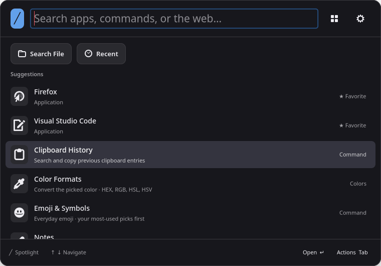

<div align="center">


# Spotlight

### 🌐 Official Website: [https://danny19862025.github.io/spotlight/](https://danny19862025.github.io/spotlight/)

**A fast, native Linux launcher built in Rust and GTK 4.**  
Launch apps, search files, calculate, manage clipboard pins, run local AI, and control your desktop — all from one keyboard shortcut.

[](https://danny19862025.github.io/spotlight/)
[](docs/GUIDE.md)
[](Cargo.toml)
[](LICENSE)

<br />



*Actual GTK 4 interface with demo data · [Explore the interactive website](https://danny19862025.github.io/spotlight/) · [See file search](docs/images/spotlight-files.png)*

</div>

---

## Why Spotlight?

- **Instant & Native:** Written in Rust and GTK 4 — no Electron, no browser engine, no account, and no cloud telemetry.
- **Built for KDE Plasma on Wayland:** Deep integration with KWin windows, virtual desktops, Klipper clipboard history, and desktop portals (core launcher, calculator, notes, and local tools also work on other GTK 4 desktops).
- **Easy for Beginners, Deep for Power Users:** Start by launching apps and finding files in seconds, then unlock encrypted clipboard pins, visual WASM workflows, local Ollama AI, Git/Docker dashboards, and 103 built-in help topics whenever you need them.

---

## Quick Start (3 Minutes)

New to Spotlight? Follow these three steps to get up and running.

### 1. Install Dependencies

Pick your Linux distribution (or skip straight to **Nix**):

<details open>
<summary><b>Ubuntu / Kubuntu / Linux Mint / Pop!_OS (24.04+) & Debian (13+)</b></summary>

```sh
sudo apt update
sudo apt install build-essential git curl ca-certificates pkg-config libgtk-4-dev libsqlite3-dev
```
</details>

<details>
<summary><b>Arch Linux / EndeavourOS / Manjaro / CachyOS</b></summary>

```sh
sudo pacman -Syu --needed base-devel git curl ca-certificates pkgconf gtk4 sqlite
```
</details>

<details>
<summary><b>Fedora Workstation / Fedora KDE</b></summary>

```sh
sudo dnf install gcc git curl ca-certificates pkgconf-pkg-config gtk4-devel sqlite-devel
```
</details>

<details>
<summary><b>openSUSE Tumbleweed / Slowroll</b></summary>

```sh
sudo zypper refresh
sudo zypper install gcc git curl ca-certificates pkgconf-pkg-config gtk4-devel sqlite3-devel
```
</details>

<details>
<summary><b>Nix / NixOS (1-Command Install)</b></summary>

```sh
nix profile install github:danny19862025/spotlight
```
See the [Nix installation guide](docs/NIX.md) for flakes and declarative configuration.
</details>

> Need Void, Gentoo, Alpine, Fedora Atomic, or packaging recipes? See the **[Full Linux Installation Guide](docs/INSTALL.md)** and **[Linux Packages](docs/PACKAGING.md)**.  
> Make sure you also have [stable Rust](https://rustup.rs/) (`cargo`) installed before building from source.

### 2. Build and Install

Run this as your normal user (**without `sudo`**):

```sh
git clone https://github.com/danny19862025/spotlight.git
cd spotlight
cargo fetch --locked
sh install.sh
"$HOME/.local/bin/spotlight"
```

### 3. Set Up Your Shortcut & Autostart

```sh
# On KDE Plasma: bind Meta+Space to open/close Spotlight
~/.local/bin/spotlight --install-shortcut

# Optional: start Spotlight hidden automatically when you log in
~/.local/bin/spotlight --autostart
```

> **Tip:** Press **`Meta+Space`** to toggle Spotlight anytime, and **`Escape`** to hide it. On non-KDE desktops, bind `~/.local/bin/spotlight` in your desktop's Keyboard Shortcuts settings.

---

## Your First 5 Minutes (Beginner Cheat Sheet)

You don't need to memorize everything! Here are the 10 everyday things most people use first:

| What you want to do | What to type or press |
| :--- | :--- |
| **Open any app** | Just type its name (e.g. `firefox`, `vscode`) and press **Enter** |
| **Find a file or folder** | Type a name and click/select **Search File** (or press **Tab** on a file for Reveal, Copy Path, Trash, Info) |
| **See recent files** | Select the pinned **Recent** button below the search bar |
| **Quick math & units** | Type `25 * 48`, `sqrt(144)`, `10 km to mi`, `32 f to c`, or `100 USD to EUR` |
| **Clipboard history** | Type `clip` to browse text & image history, or `clip pinned` for encrypted pins |
| **Quick note or todo** | Type `note call Alex tomorrow` or `todo add buy milk` |
| **Timers & focus** | Type `timer 5m`, `alarm 7:30 am`, or `pomodoro 25m` (auto-keeps screen awake) |
| **Pick a color or measure** | Type `color picker` (HEX/RGB/HSL) or `measure` (on-screen pixel ruler) |
| **Control your desktop** | Type `volume up`, `wifi`, `bluetooth`, `dark mode`, `dnd`, or `music` |
| **Open the built-in Guide** | Press **`F1`** anytime to search **103 interactive help topics** |

---

## Essential Keyboard Shortcuts

| Shortcut | What it does |
| :--- | :--- |
| **`Meta+Space`** | Open or hide Spotlight (KDE shortcut) |
| **`↑` / `↓`** or **Hover** | Select a result |
| **`Enter`** | Open, copy, or run the selected item |
| **`Tab`** or **`Ctrl+K`** | Open the **Actions menu** (or expand a snippet trigger with `Tab`) |
| **`Ctrl+Enter`** | Search the web directly from the search bar |
| **`Escape`** | Go back one screen, then hide Spotlight |
| **`F1`** | Open the **103-topic Built-in Guide** |
| **`Ctrl+,`** | Open **Settings** (Themes, Window size, Aliases, Dotfiles sync) |
| **`Ctrl+F`** | Favorite / unfavorite the selected item |
| **`Ctrl+N` / `Ctrl+E` / `Ctrl+D`** | Create / Edit / Delete a snippet, note, or quicklink |
| **`Ctrl+R`** | Refresh live results (or generate a fresh UUID) |

---

## Everything Spotlight Can Do

Spotlight grows with you. Explore all capabilities below, or jump straight to the **[Complete User Guide (docs/GUIDE.md)](docs/GUIDE.md)** for step-by-step walkthroughs.

### Everyday Search & Productivity
- **Fuzzy App Launcher:** Ranks apps by match quality, favorites, and frequency of use.
- **Dedicated File & Recent Views:** Pinned **Search File** and **Recent** buttons keep main search clean; supports image thumbnails, full paths, `.spotlightignore`, and file quick actions (**Tab** / **Ctrl+K**: Reveal in Dolphin, Copy Path, Copy File, Open With, Get Info, Trash).
- **Inside-File Content Search:** `rg rust`, `content TODO`, or `in: notes keyword` streams matches using `ripgrep` with inline previews.
- **Calculator, Units & Live Currency:** Full math (`pi`, `sqrt`, trig, percentages), unit conversions (`10 km to mi`, `1 gib to mib`), and daily currency rates (`100 USD to AUD`) via Frankfurter.
- **Dictionary, Offline Translate & Cheat Sheets:** `define serendipity`, `translate en es cat` (local dictd/FreeDict), and `tldr tar` / `cheat curl` with inline sheets.
- **Notes, Todos & Snippets:** Quick Notes with automatic **Obsidian vault** detection, Markdown checkboxes (`todo add ...`), and trigger snippets (`;sig` + Space/Tab, plus optional desktop-wide **Espanso** sync).
- **Calendar & Meeting Availability:** Type `event Dinner on July 13 2027 at 6pm` to create GNOME/Evolution or local events, search with `calendar Birthday`, or find free slots with `meet in 2h`.
- **Emoji, Kaomoji & Fonts:** Everyday emoji picker with skin-tone memory, `shrug` / `kaomoji`, and live system font preview (`fonts`).

### Security, Privacy & Local AI
- **Secure Clipboard Vault:** Type `vault` to protect sensitive text & image pins with **Argon2id + XChaCha20-Poly1305** encryption, automatic 1-hour expiry, sensitive clipboard metadata, and an in-memory **Paste Queue** (`clip queue`).
- **Visual No-Code WASM Workflows:** Type `workflow` to visually chain actions like `Screenshot → OCR → Translate → Save Note` compiled into real import-free Wasmi modules.
- **Context-Aware Local AI:** Type `ai ask ...` or `ai summarize clipboard` using verified loopback-only **Ollama** (`OLLAMA_NO_CLOUD=1`) with an explicit preview of project files, open windows, and todos before sending.
- **Passwords & File Vault:** Copy secrets via `rbw` or `KeePassXC` (`pass github`) with 30-second clipboard expiry; run local GPG encryption/decryption, SHA-256 checksums, and confirmed file shredding (`encrypt file`, `checksum file`, `shred file`).

### Developer Superpowers
- **Recent IDE Projects & Context:** `code myproject`, `jetbrains myproject`, and `project ~/Projects/app` set active context for GitHub and dotenv tools.
- **Git & Container Dashboard:** `git status` shows all dirty repos under `~/Projects`; `docker logs nginx` tails live logs inside Spotlight; `docker exec nginx` opens an interactive shell.
- **HTTP Scratch Client & Dotenv Diff:** `get https://api.github.com/user` opens a quick REST client with pretty-printed JSON; `dotenv diff` compares `.env` against `.env.example`.
- **SSH, GitHub & Text Generators:** `ssh myserver`, `gh pr list`, `gh issue bug`, `env PATH`, `uuid`, `hash mytext`, `base64 encode ...`, `json format ...`, `case snake ...`, `lorem 5`, offline `qr hello`, and Tesseract `ocr`.
- **WASM Extension Store & Script Commands:** Type `store` to install SHA-256 verified sandboxed WASM plugins, or drop executable scripts in `~/.local/share/spotlight/scripts/`.

### Desktop, Media & Image/PDF Toolkit
- **Image, Screenshot & PDF Tools:** `screenshot` (with instant OCR, QR decode, Compress, Pin, Save), `compress image 50%`, `resize 1080p`, `image to webp`, `palette`, and `pdf text`.
- **KDE Window Manager & Layouts:** Tile windows into halves/quarters, switch windows/virtual desktops (`window`, `desktop`, `switch`), and save/restore full workspace layouts (`layout save work` / `layout work`).
- **Music & Browser Integration:** Direct MPRIS controls (`music`, `pause`, `next track`, `play lofi`), plus local history, bookmark, and tab search across Firefox, Chrome, Chromium, and Brave (`history`, `bookmark`, `tabs chrome`).
- **System, Network & Appearance:** `ip`, `battery`, `disk`, `ram`, `uptime`, `ping`, `dig`, `my ports`, `scan wifi`, `speakers`, `bluetooth connect`, `apt`/`pacman`/`flatpak` search, `service status`, `wallpaper next`, `accent blue`, and **Dark / Light / Midnight** themes with custom accent glow.

---

## Documentation Hub

| Guide | What's inside |
| :--- | :--- |
| **[Complete User Guide](docs/GUIDE.md)** | Full step-by-step manual from first launch to power-user workflows |
| **[Linux Installation Guide](docs/INSTALL.md)** | Distro-by-distro setup, Rust toolchain, shortcuts, updates, troubleshooting |
| **[Tools & Integrations Reference](docs/TOOLS.md)** | Commands, dependencies, local AI, Extension Store, Git/Docker/HTTP, dotfiles sync |
| **[Secure Vault, Workflows & AI](docs/SECURE_WORKFLOWS.md)** | Argon2id/XChaCha20-Poly1305 vault, visual WASM workflows, context AI |
| **[Calendar & Contacts (PIM)](docs/PIM.md)** | Evolution Data Server, Akonadi bridge, and local-only iCalendar setup |
| **[WASM Plugins & Extensions](docs/WASM.md)** | Build sandboxed Rust/C plugins with the Spotlight SDK ([schema](docs/EXTENSIONS.md)) |
| **[Offline Dictionaries](docs/OFFLINE.md)** | Install local FreeDict / dictd dictionaries for offline translation |
| **[Nix & Packaging](docs/NIX.md)** | Nix flakes ([NIX.md](docs/NIX.md)) and `.deb` / `.rpm` / Arch recipes ([PACKAGING.md](docs/PACKAGING.md)) |
| **[Release Notes](CHANGELOG.md)** | Full version history and latest improvements |

---

## Customization, Privacy & Maintenance

<details>
<summary><b>Exclude folders from file search (~/.spotlightignore)</b></summary>

Create `~/.spotlightignore` using standard gitignore patterns, then press **Ctrl+R** in Search File or Recent:

```gitignore
# Keep private folders and large caches out of file search and Recent
/Private/
/Downloads/archive/
*.log
**/cache/
!important.log
```
</details>

<details>
<summary><b>Data, Privacy & Resource Usage</b></summary>

- All local data lives in `~/.local/share/spotlight` (or `$XDG_DATA_HOME/spotlight`) with private permissions (`0600`).
- Uses GTK's Cairo renderer (no GPU context overhead), lazy background file indexing, and zero continuous polling when hidden.
- Clipboard pins are encrypted with Argon2id + XChaCha20-Poly1305 and expire after 1 hour.
- Local AI refuses cloud endpoints and requires `OLLAMA_NO_CLOUD=1` on `127.0.0.1`.
- Online lookups happen **only** when you explicitly invoke currency (Frankfurter), dictionary (Free Dictionary API), uncached `tldr` pages (GitHub), public `ip`, or web search.
- Emoji metadata is bundled locally from [Unicode Emoji 17.0](https://unicode.org/Public/17.0.0/emoji/emoji-test.txt) under the [Unicode License V3](assets/UNICODE-LICENSE.txt).
- Spotlight is an independent native Linux launcher inspired by keyboard-first workflows, not a Raycast port.
</details>

<details>
<summary><b>Development Checks & Verification</b></summary>

```sh
cargo fmt --all -- --check
cargo clippy --locked --all-targets -- -D warnings
cargo test --locked --all-targets
```

Desktop and feature smoke tests live in `tests/` (`usability_smoke.py`, `interface_smoke.py`, `guide_smoke.py`, `deep_features_smoke.py`, `devkit_smoke.py`, `productivity_smoke.py`, `workflow_smoke.py`, `search_smoke.py`, `calendar_smoke.py`, `plus_smoke.py`, `superpowers_smoke.py`). Run `spotlight --diagnostics` for memory stats or `spotlight --quit` to stop a running instance.
</details>

<details>
<summary><b>Uninstall Spotlight</b></summary>

```sh
spotlight --no-autostart
rm -rf ~/.local/bin/spotlight \
       ~/.local/lib/spotlight \
       ~/.local/share/applications/spotlight.desktop \
       ~/.local/share/kglobalaccel/spotlight.desktop \
       ~/.local/share/icons/hicolor/scalable/apps/spotlight.svg
```
Remove its shortcut in **KDE System Settings → Keyboard → Shortcuts**. Your saved notes, snippets, and data remain untouched in `~/.local/share/spotlight` unless you delete that folder yourself.
</details>

---

<div align="center">
  <sub>MIT License · Built with Rust &amp; GTK 4 · <a href="https://danny19862025.github.io/spotlight/">Visit the Spotlight Website</a></sub>
</div>
