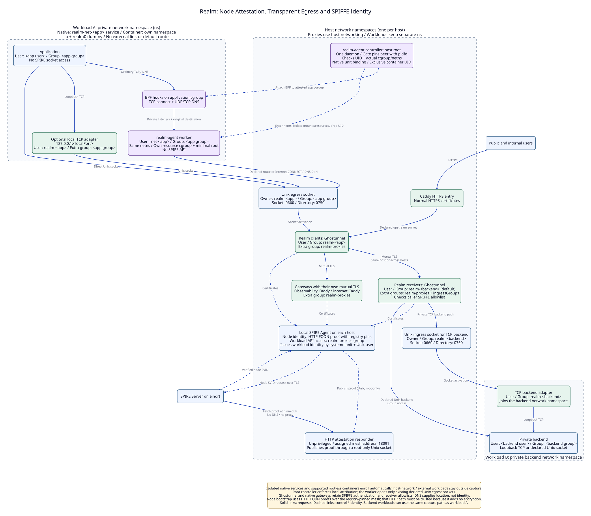
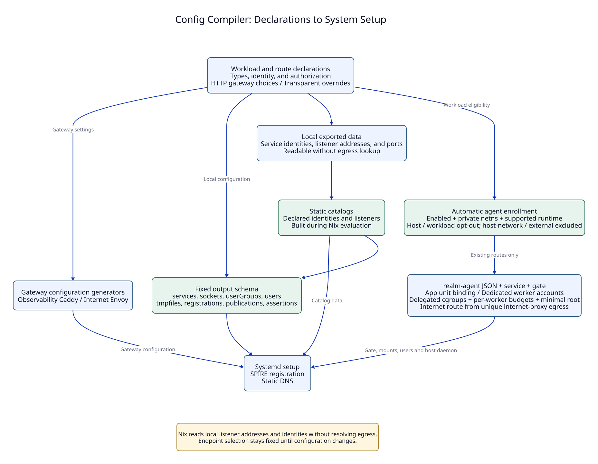

# NixOSs

[](https://nixos.org/)

[](https://github.com/oluceps/nixos-config/actions?query=branch%3Atrival)

One flake for a small fleet of personal machines and VPS, joined by a routed overlay mesh. Services find each other by identity, not by address, and every route between them is declared.

## The ideas

- **One source of truth.** [`registry.toml`](registry.toml) lists every node; flake-parts modules turn it into each host's network, secrets, disks and routing. A host file only picks the modules it wants.
- **Identity, not addresses.** [SPIRE](https://spiffe.io/) gives every workload a short-lived certificate. Services talk over mutual TLS and accept only the callers they allow; DNS names and mesh membership grant nothing.
- **Workloads in boxes.** Applications run as isolated systemd units with private networks and only the sockets they are given. Their outbound traffic leaves through declared, filtered egress.
- **Locked disks.** Several hosts keep their roots on LUKS. Eihort's root unlocks over the network through [nbde](https://github.com/milieuim/nbde): two of three gate servers must agree. A planned reboot unlocks unattended; an unplanned one waits for a hardware security key to approve it.
- **Encrypted secrets.** [Vaultix](https://github.com/oluceps/vaultix) keeps secrets encrypted in the repository and decrypts them only on the hosts that need them.

## Architecture

<table width="100%">
<tr>
<td width="50%" valign="top"><a href="layout/realm-overview.svg"></a></td>
<td width="50%" valign="top"><a href="layout/config-compiler.svg"></a></td>
</tr>
</table>

Left: how a request travels and where identities are checked. Right: how declarations become system configurations. [More diagrams](layout/README.md).

## Security controls

| Boundary | Control | Where |
| --- | --- | --- |
| Application → host | Private network, dropped capabilities, hidden host `/run`, explicit socket mounts. | [Workload isolation](lib/realm/base.nix) |
| Service → service | Certificates bound to systemd unit and Unix user; clients check the server, servers check the caller. | [SPIRE](nixosModules/realm-spire.nix), [client](lib/realm/egress.nix), [receiver](lib/realm/ingress.nix) |
| Node → cluster | A node proves its name by answering a short-lived challenge at an address pinned in the registry. No join tokens. | [HTTP attestation](docs/realm-http-attestation.md) |
| Proxy → host | Proxies run sandboxed: no capabilities, syscall filters, no writable-executable memory. | [Sandbox](lib/realm/common.nix), [hardening](lib/proxy-hardening.nix) |
| Workload → Internet | The gateway authenticates callers and blocks private ranges, cloud metadata and unlisted ports. | [Gateway policy](lib/realm/caddy-internet.nix) |
| Repository → secrets | Secrets are stored encrypted to configured recipients. | [Vaultix](mod/vaultix.nix) |
| Administrator → host | SSH without passwords, through a user certificate authority. | [SSH policy](mod/openssh.nix) |
| Disk at rest | LUKS on hastur, kaambl and eihort. Lanzaboote signs the boot chain on hastur and kaambl. Roots are transient: only declared paths survive a reboot. | [Disks](mod/disko/), [Secure Boot](mod/secureboot.nix), [preservation](mod/empheral-root.nix) |
| Boot → disk key | Eihort's key is released only when 2 of 3 gates (yidhra, abhoth, nodens) agree: a pre-announced reboot, or an approval signed with a security key. | [nbde setup](mod/nbde.nix), [design](docs/draft/unlock-gate.md) |

Certificates last one hour, and so does any single proxied connection.

## Threat model

**Protects:** service data, runtime secrets, workload identities, host integrity, data on disk.

**Against:** an untrusted network client, someone who can tamper with DNS, code running inside one unprivileged application, and someone who takes eihort's disk or the whole machine.

**Trusts:** each host's root and kernel, SPIRE and its administrators, the deployment keys and the Nix inputs, and for disk unlock the gate hosts, the approvers' security keys and the offline recovery key.

| Threat | What stops it | What it does not stop |
| --- | --- | --- |
| A peer pretends to be a service | mTLS checks the expected identity and the caller allowlist. | Applications still do their own user authorization. |
| A compromised app reaches other services | Private networks and per-service socket access. | Its declared routes stay usable, including allowed Internet egress. |
| A rogue node joins the cluster | The challenge is fetched from the pinned address and bound to one session. | The mesh is not encrypted; whoever controls a mesh router or the registry can redirect it. |
| SSRF to internal addresses | The Internet gateway checks resolved addresses and ports. | Explicitly declared internal routes. |
| The repository leaks | Secrets are ciphertext. | Host root reads its decrypted secrets. |
| Eihort is stolen or booted unexpectedly | No unlock without 2 of 3 gates; an unplanned boot needs a security-key approval, and every release is reported to Telegram. | Root on any two gates can approve without the security key. Eihort has no Secure Boot yet, so someone with physical access can alter its initrd and capture the key at the next legitimate unlock. |

All of this assumes the trusted parts stay intact. Isolated workloads share the host kernel, so they are not virtual machines, and none of it promises availability.

## Built with

[flake-parts](https://github.com/hercules-ci/flake-parts) · [Vaultix](https://github.com/oluceps/vaultix) · [SPIRE](https://spiffe.io/) · [Ghostunnel](https://github.com/ghostunnel/ghostunnel) · [Caddy](https://caddyserver.com/) · [nbde](https://github.com/milieuim/nbde) · [Lanzaboote](https://github.com/nix-community/lanzaboote) · [Disko](https://github.com/nix-community/disko) · [preservation](https://github.com/WilliButz/preservation) · [nix-topology](https://oddlama.github.io/nix-topology/)

**Read more:** [Realm](docs/realm.md) · [Deployment](docs/realm-deployment.md) · [Observability](docs/realm-observability.md) · [Network unlock](docs/draft/unlock-gate.md) · [Eihort LUKS migration](docs/eihort-luks-migration.md) · [Hardening record](docs/systemd-hardening.md) · [VM tests](tests/)

<details>
<summary>Inspect declared access and render the diagrams</summary>

Run from the repository root:

```sh
nix eval --json .#nixosConfigurations.eihort.config.realm.authorization.matrix
nix eval --json .#nixosConfigurations.eihort.config.realm.authorization.connections
bash layout/render.sh
```

The queries show configured access and connections. Check the running generation and service state separately when checking a deployment.

</details>

<details>
<summary>Generated network topology</summary>


</details>
