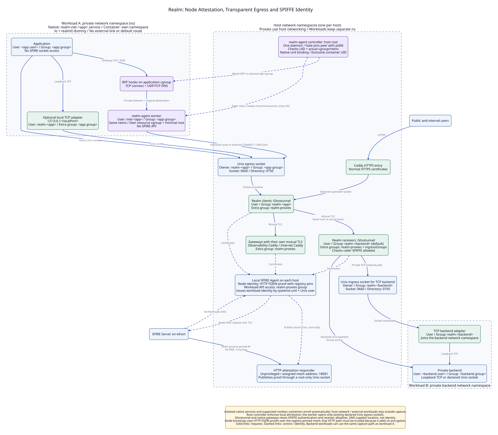
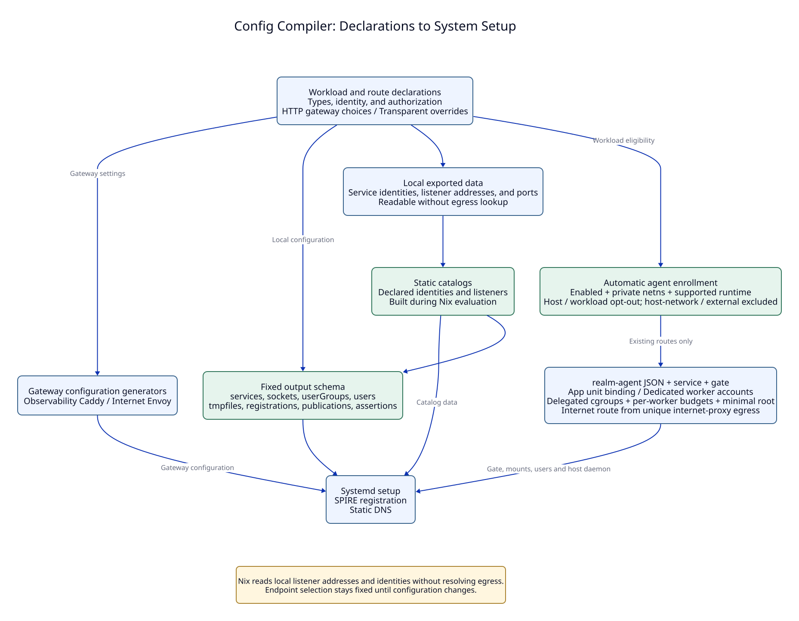

# NixOSs

[](https://nixos.org/)

[](https://github.com/oluceps/nixos-config/actions?query=branch%3Atrival)

Declarative NixOS infrastructure with isolated workloads, explicit service identities, and controlled routes between services.

## Architecture

Open either image for the full-size diagram.

<table width="100%">
<tr>
<td width="50%" valign="top"><a href="layout/realm-overview.svg"></a></td>
<td width="50%" valign="top"><a href="layout/config-compiler.svg"></a></td>
</tr>
</table>

[All diagrams and sources](layout/README.md) · [Transparent agent](layout/transparent-egress.svg) · [Local transport](layout/local-transport.svg) · [Outbound example](layout/http-egress.svg) · [Immich routing](layout/immich-routing.svg)

Public Caddy terminates normal HTTPS. Its Ghostunnel proxies carry its Realm identity to private backends. Observability Caddy and Internet Envoy handle their own mutual TLS (mTLS). SPIRE supplies certificates through local Agents. The host realm-agent captures ordinary TCP/DNS for eligible isolated workloads and forwards through their existing declared egress sockets; SPIFFE authentication stays in the proxies and gateways.

## Implemented security controls

These controls describe the declared configuration. Host imports and explicit workload exceptions determine where each control applies.

| Boundary | Control | Implementation |
| --- | --- | --- |
| Application → host | Isolated systemd workloads use private networks, restricted capabilities, a hidden host `/run`, and explicit socket mounts. | [Workload isolation](lib/realm/base.nix) |
| Service → service | SPIRE binds identity to unit and Unix user selectors. Clients check the server identity. Receivers enforce caller allowlists. | [SPIRE](nixosModules/realm-spire.nix), [client](lib/realm/egress.nix), [receiver](lib/realm/ingress.nix) |
| Proxy → host | Realm proxies drop capabilities and use `NoNewPrivileges`, filesystem protection, syscall filters, and `MemoryDenyWriteExecute`. | [Sandbox](lib/realm/common.nix), [shared restrictions](lib/proxy-hardening.nix) |
| Workload → Internet | Envoy authenticates callers, filters private and selected special address ranges, and restricts upstream ports. Extra CONNECT ports require identity rules. | [Gateway policy](lib/realm/envoy-internet.nix), [site rules](mod/realm-internet.nix) |
| Repository → runtime secrets | Vaultix manages encrypted secret files for configured recipients and hosts. | [Secret management](mod/vaultix.nix) |
| Administrator → host | The shared SSH policy disables password authentication and trusts the configured user certificate authority. | [SSH policy](mod/openssh.nix) |
| Boot and storage | Selected hosts use Lanzaboote boot signing, LUKS volumes, and transient roots with explicit preserved paths. | [Secure Boot](mod/secureboot.nix), [disk layouts](mod/disko/), [preservation](mod/empheral-root.nix) |

SPIRE certificates default to a one-hour lifetime. Ghostunnel separately caps connection lifetime at one hour. Applications use direct Unix sockets, loopback adapters, or the transparent worker to reach declared egress. The dedicated TLS gateways have direct SPIRE Agent access.

## Defensive threat model

**Assets:** service data, runtime secrets, workload identities, and host integrity.

**Attacker:** an untrusted network client, a party that can influence DNS, or an attacker with code execution inside one unprivileged application.

**Trusted base:** host root and kernel, systemd, the realm-agent controller, SPIRE, enrollment administrators, deployment keys, and the deployed Nix policy and inputs.

| Threat | Boundary and defense | Remaining authority or limit |
| --- | --- | --- |
| Network peer impersonates a service | mTLS checks the expected service identity and receiver allowlist. DNS names do not grant identity. | Public applications still need user and resource authorization. |
| Compromised application moves to another service | Private networks, explicit socket access, and separate proxy accounts restrict reachable services and identity access. | Its allowed routes remain usable. Allowed public egress can carry stolen data. |
| SSRF targets private addresses or cloud metadata | The Internet gateway filters DNS answers and checks literal and selected upstream addresses and ports. | This policy covers the Internet gateway. Explicit internal routes retain their configured authority. |
| Reader obtains repository secret files | Vaultix ciphertext requires an authorized decryption identity. | The application can read its own runtime secrets. Host root can read decrypted secrets. |
| Attacker modifies boot files or reads a locked disk | Selected hosts configure boot signing and encrypted volumes. | Protection depends on host scope, firmware key enrollment, and volume state. Persistent paths survive reboot. |

Gateway admission covers the listener. `resolveHosts` and `NO_PROXY` select routes and proxy behavior. They do not define per-domain or per-user authorization.

The model assumes the trusted base remains intact. Shared-kernel isolation does not establish a virtual-machine boundary. Certificate expiry does not terminate every existing TLS connection, and these controls do not guarantee availability.

## Configuration and checks

Built with [flake-parts](https://github.com/hercules-ci/flake-parts), [Vaultix](https://github.com/oluceps/vaultix), [Lanzaboote](https://github.com/nix-community/lanzaboote), [preservation](https://github.com/WilliButz/preservation), [Disko](https://github.com/nix-community/disko), and [nix-topology](https://oddlama.github.io/nix-topology/).

[Realm reference](docs/realm.md) · [Deployment](docs/realm-deployment.md) · [Hardening test record](docs/systemd-hardening.md) · [VM tests](tests/realm-vm.nix)

<details>
<summary>Inspect declared access and render the diagrams</summary>

Run from the repository root:

```sh
nix eval --json .#nixosConfigurations.eihort.config.realm.authorization.matrix
nix eval --json .#nixosConfigurations.eihort.config.realm.authorization.connections
bash layout/render.sh
```

The queries show configured access and connections. Check the running generation and service state separately when checking a deployment.

</details>

<details>
<summary>Generated network topology</summary>


</details>
